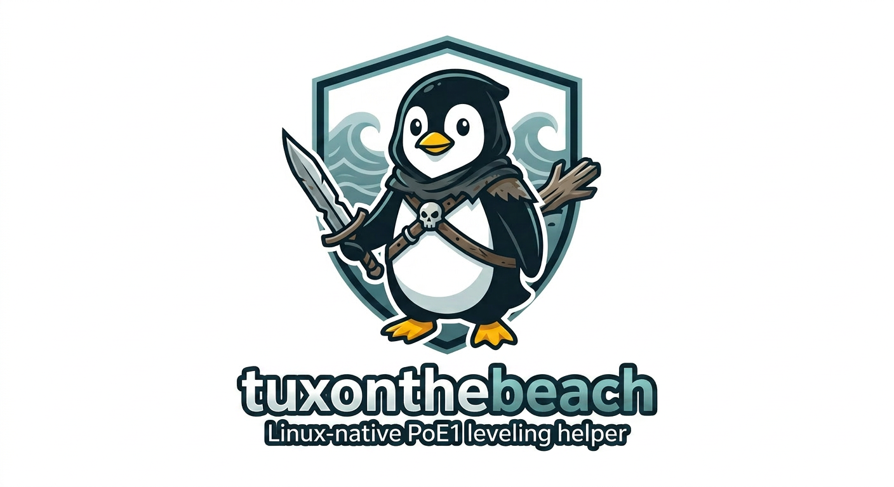

# TuxontheBeach

<p align="center">
  
</p>

Linux overlay for Path of Exile leveling — tracks your progress automatically.

GTK4 + `wlr-layer-shell` build. Native Wayland, no compositor hacks.

## Installation

```bash
# Arch / CachyOS
sudo pacman -S gtk4-layer-shell python-gobject
pip install watchdog --break-system-packages
sudo pacman -S wl-clipboard xclip python-evdev   # regex "Send" (xclip reaches games inside gamescope, evdev types Ctrl+F/V)

# Clone
git clone https://github.com/sandrigo/tuxonthebeach.git
cd tuxonthebeach

# Run
python3 tuxonthebeach_gtk.py
```

Compatible compositors: **niri, sway, Hyprland, river, KDE Plasma**. GNOME/Mutter isn't supported (no layer-shell).

## Usage

1. **Import Route**: Click ⬇ → paste JSON from [exile-leveling.io](https://heartofphos.github.io/exile-leveling/)
2. **Import gem links (optional)**: copy your PoB code or a pobb.in / pastebin / poe.ninja link, click ⬇ again — the import auto-detects what's in the clipboard
3. **Auto-Track**: Automatically follows your zone changes via PoE's `Client.txt`
4. **Navigate**: Use ◄ ► buttons, or click on the step counter to **jump** to any step

### Quick controls

| Button | Action |
|---|---|
| ⬇ | Import route from clipboard |
| ⚙ | Settings (character, build, opacity, font, log path) |
| ? | About |
| ✕ | Close (with confirmation) |
| ◄ ► | Previous / next step |
| 💎 | Toggle gem overlay |
| 🔗 | Gem-links popout (from PoB) |
| 🔍 | Search-regex popout (missing gems, vendor presets, your own) |
| **X/Y** counter | Click to jump to a specific step |
| ▴ / ▾ (blue, bottom-right outer) | Hide / show titlebar (acts as a window-lock — see below) |
| ▢ (gold, bottom-right outer) | Drag-resize handle |

You can also drag the window via the **header** OR the **zone label** (handy when the titlebar is hidden).

### Preview a level

Tips, breakpoints and the gem-set pick only show what's relevant to your current level (an endgame character sees none of the Act 1 recipes). To see what a level looks like, start a preview next to your normal overlay:

```bash
python3 tuxonthebeach_gtk.py --level 24
```

Tips you dismiss in preview mode come back when you really reach that level.

## Settings (⚙ button)

- **Character name** — switches the active progress profile. Each character gets its own `progress_<name>.json`, so multiple alts can be tracked independently. Empty = shared default profile.
- **Build** — display string shown in the titlebar (e.g. *"Witch · SRS"*). Pure cosmetic.
- **Client.txt path** — manual override. Auto-discovery covers `~/.steam`, `~/.local/share/Steam`, Proton prefixes, and external libraries under `/mnt/*`, `/run/media/*`, `/media/*`. *Tip: in Steam, right-click Path of Exile → Manage → Browse local files → `logs/Client.txt`.*
- **Opacity** — overlay transparency slider (30–100%), live preview.
- **Step font** — maximum font size (8–20pt) for the step text. The text auto-shrinks below this when content is long, so everything stays visible without scrollbars.

All settings persist to `~/.config/tuxonthebeach/config.json`.

## Features

- 🌊 **Native Wayland** — uses `wlr-layer-shell` for proper always-on-top behaviour (no XWayland hacks, no KDE-only window rules)
- 🗺️ **Auto zone detection** via `Client.txt` (with smart skip — won't jump to Act 6 Mud Flats when you re-enter Act 1)
- 💎 **Inline gem overlay** showing the next 3 gems, with smooth slide animation
- 💰 **Vendor gem prices** — vendor gem steps and the links popout show what each gem costs (Wisdom < 8, Transmute < 16, Alteration < 28, Chance < 38, Alchemy above — by required level, same rule as exile-leveling)
- 💡 **Level & area tips** — a small yellow bar pops up when a level unlocks something useful: weapon / movement-speed / resistance-ring vendor recipes, 4/5/6-socket item-level thresholds, Kitava's resistance penalty after Act 5 and 10. Click to dismiss (saved per character), hover for details. Every level-up also flashes a "vendors restocked" reminder. Tips live in `tips.json` (override via `~/.config/tuxonthebeach/tips.json`).
- 🔗 **Gem links popout** — import your PoB and see which gems go together, per socket group (biggest links first, actives before their supports). Picks the skill set matching your level from its title (`1-17`, `Lvl 18-31`, `70+`…) and follows along as you level; switch sets via the dropdown. Click a gem to tick it as owned (✓) — or "✓ all" once you've bought the whole set. Gems you couldn't buy simply stay open (○) and keep showing up in later sets that use them. The cost line on top sums the currency for the open gems only (quest rewards from your route count as free; duplicates in two groups count twice). Hover a gem to see which vendor sells it to your class and after which quest, plus the all-class fallback (Siosa in Act 3, Lilly Roth in Act 6). The 🔗 button shows how many gems of your current set are still missing (`🔗 3`, or `🔗 ✓`). The exile-leveling export doesn't contain links, so this needs the PoB code.
- 🔍 **Search regex** — popout with ready-to-paste regexes for the vendor/stash search: your still-missing gems of the current PoB set (poe.re's short per-gem tokens, auto-split at the 250-char client limit), a vendor builder with poe.re's patterns — pick a *minimum* link count (link regexes are cumulative: 3+ already matches 4/5/6-links; "auto" follows your level: 3+ / 4+ from 25 / 5+ from 35 / 6 from 50) and OR in movement speed, +1 wands or %phys, all in one search and your own — copy one on [poe.re](https://poe.re) and click "＋ Add from clipboard". **▶ Send** puts it on the clipboard — the desktop one *and* every running gamescope session's (gamescope doesn't sync the host clipboard into its Xwayland) — then presses **Ctrl+F, Ctrl+A, Ctrl+V** in the game through a small uinput keyboard (`/dev/uinput` must be writable, e.g. via the `input` group/uaccess; falls back to `ydotool`). Regexes containing a space are wrapped in quotes automatically, as PoE requires. On niri, keys are only sent when the game (or gamescope) window has focus — otherwise it's just copied. The overlay itself no longer takes keyboard focus, so clicking it keeps the game focused. poe.re's gem tokens are downloaded once to `~/.config/tuxonthebeach/` (not bundled); offline, unique name prefixes are used instead.
- 📈 **Level breakpoints** — reads your level from `Client.txt` and shows the next target (e.g. *Lvl 25 @ The Docks*), colored by how far behind you are. Entering a breakpoint area under-leveled turns the bar red. Hover the bar for the full checklist. Targets live in `breakpoints.json`; drop a copy into `~/.config/tuxonthebeach/` to override them.
- 🎯 **Dynamic font fitting** — long steps auto-shrink to fit the window, no scrolling
- 🔒 **Hide-titlebar = lock** — collapses the header AND keeps the window perfectly anchored at the bottom edge, so a content/font change can't shift it out from under the cursor
- 👥 **Multi-character profiles** — name your character in settings, get a dedicated progress file
- 💾 **Position, size, opacity, font, gem toggle, titlebar state — all persisted** between sessions
- 🎨 **Adjustable opacity** with live preview
- ⚡ **Fast & minimal UI** with smooth animations

## Compositor support

| Compositor | Supported |
|---|---|
| niri | ✅ |
| sway | ✅ |
| Hyprland | ✅ |
| river | ✅ |
| KDE Plasma (Wayland) | ✅ |
| GNOME / Mutter | ❌ (no layer-shell) |
| X11 anything | ❌ |

## Files

All files must live in the same directory:

- `tuxonthebeach_gtk.py` — the overlay
- `update_data.py` — pulls latest `areas.json` / `gems.json` / `quests.json` from upstream
- `gems.json`
- `areas.json`
- `quests.json`
- `tips.json` — level/area tips (recipes, socket thresholds, Kitava)
- `breakpoints.json` — level breakpoints (Hailrake 4, Dweller 8, Climb 7½, Docks 25, Dialla 27, Piety 29, Library 31, Mines 2 33, Lab 34)

Data sourced from [HeartofPhos/exile-leveling](https://github.com/HeartofPhos/exile-leveling).

### Updating game data (new PoE patch)

When a new league drops (e.g. 3.27 → 3.28), refresh the JSONs with:

```bash
python3 update_data.py
```

The script checks each file's git blob SHA against upstream, downloads only what changed, and prints the latest commit (date + message) so you see which patch the data targets. State is kept in `.exile_data_versions.json`. Pass `--force` to re-download regardless. Set `GITHUB_TOKEN` in your env if you hit GitHub's anonymous rate limit.

## Notes

- Suppresses GTK4 Vulkan resize warnings by setting `GSK_RENDERER=gl` automatically — override with your own env var if needed.
- Auto-relinks `libgtk4-layer-shell.so` via `LD_PRELOAD` on first launch (a quirk of layer-shell + Python imports).

## Credits

Inspired by:
- [Exile-Leveling](https://heartofphos.github.io/exile-leveling/) by HeartofPhos
- [Exile-UI](https://github.com/Lailloken/Exile-UI) by Lailloken

## License

MIT
